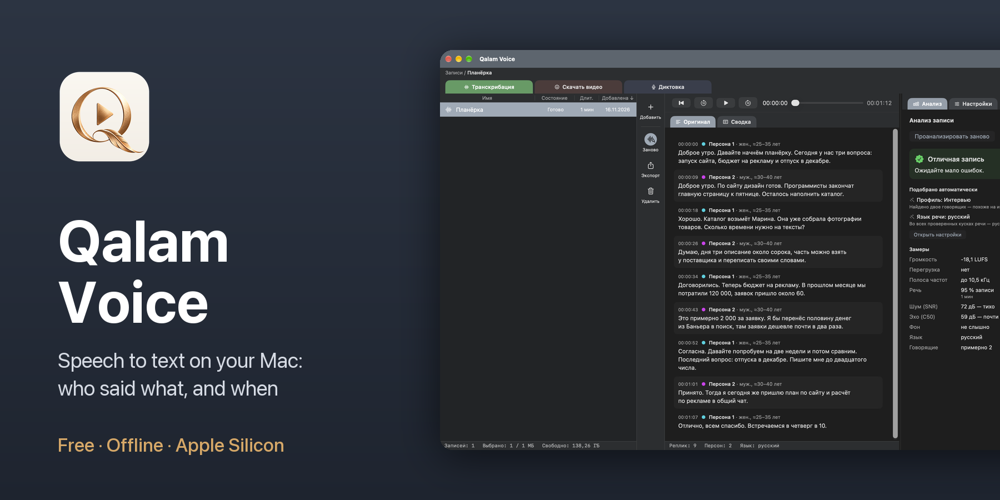
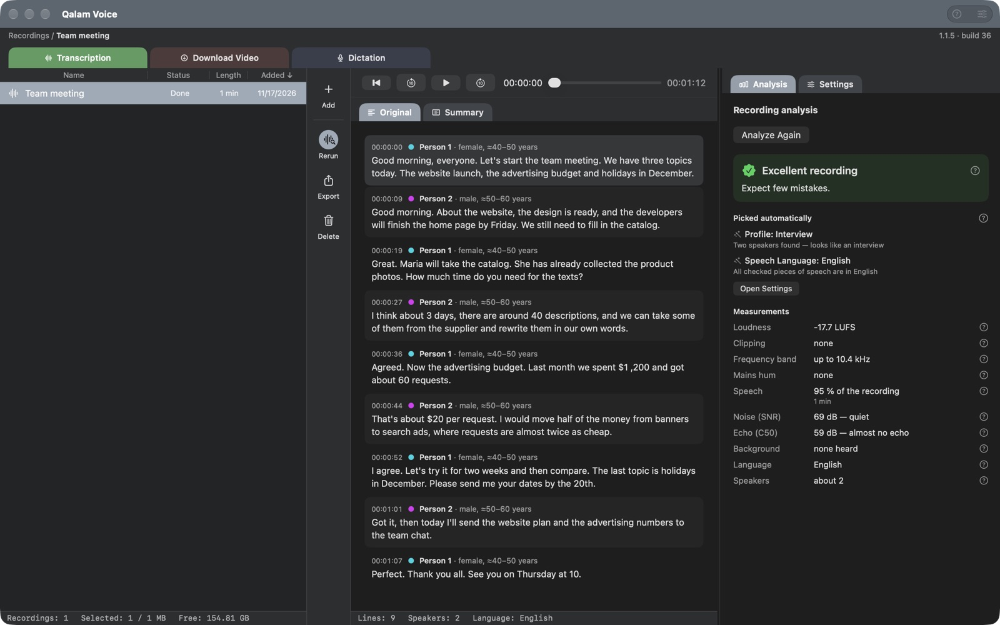
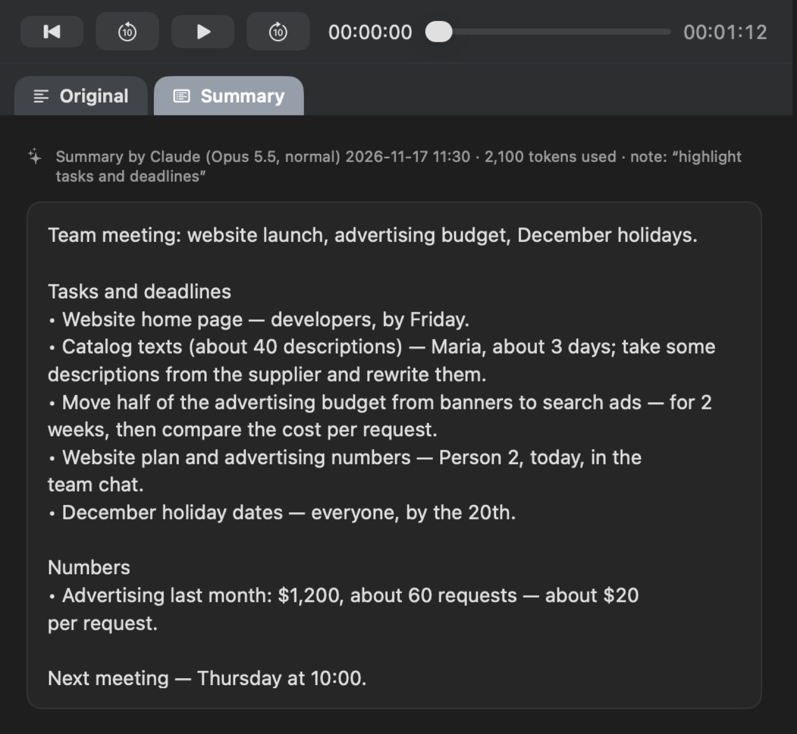
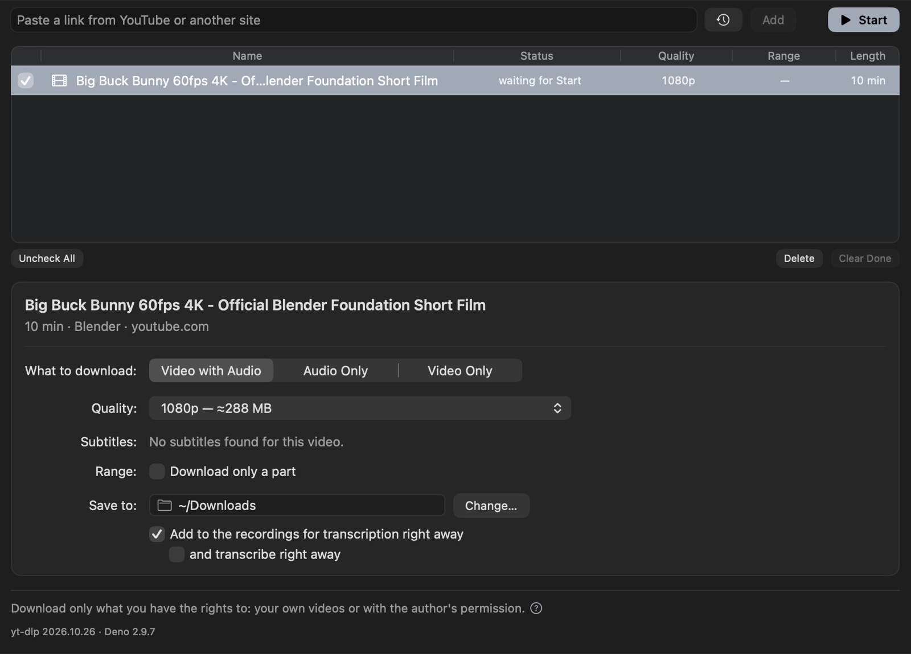
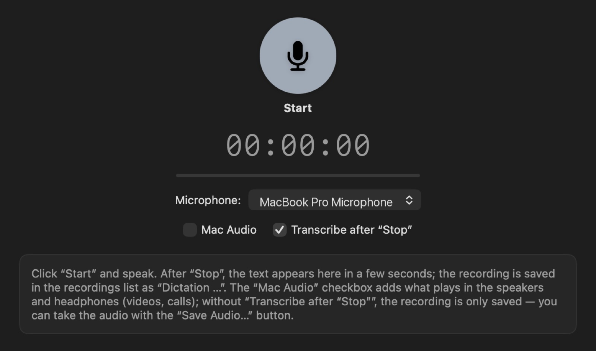
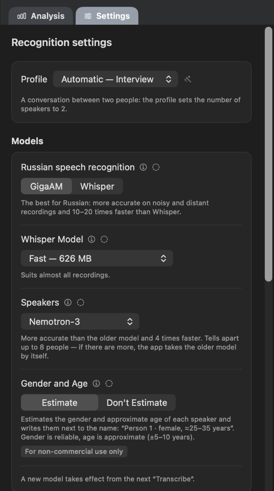
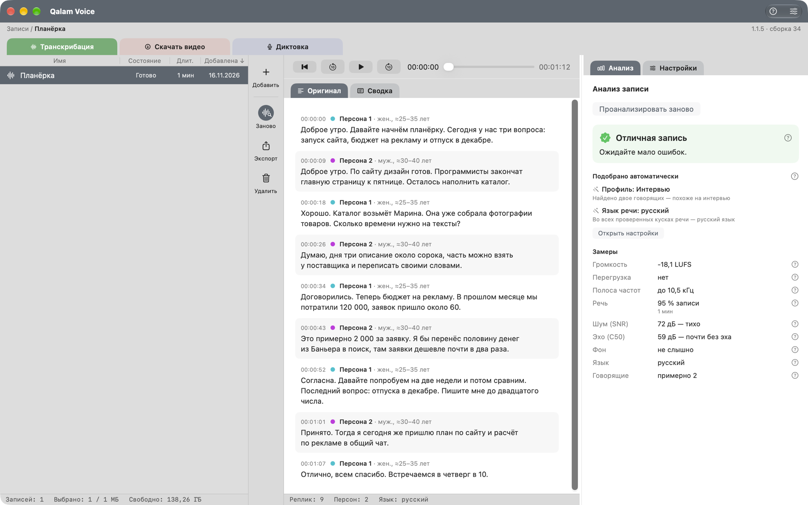

# Qalam Voice

Speech to text for macOS, in English and Russian. Drop in an audio or video file and get the text split by speaker, with the time of every line: who said what, and when. Recognition runs entirely on your Mac; the sound never leaves it.

**[Download the latest release](https://github.com/Toys-D/QalamVoice/releases/latest)** · macOS 15 (Sequoia) or newer · Apple Silicon · free

| | |
|:---:|:---:|
|  |  |
| **The assistant:** fix mistakes, translate, summarise — as separate versions of the text | **Video by link:** YouTube and other sites, a queue with settings for each link |
|  |  |
| **Dictation:** speak into the microphone, add the Mac's own sound if you need it | **Settings:** profiles, models and every knob explained in place |

## How it works

1. **Add a recording.** Drag an audio or video file into the window, or paste a link on the **Download video** («Скачать видео») tab.
2. **Recognise.** Press **Recognise** («Распознать», ⌘R). The app finds the speech, tells the voices apart and turns them into text: «Персона 1», «Персона 2», with an estimate of gender and age if you want it.
3. **Read, listen, fix.** Click a line to hear that moment; rename the speakers, correct the text, scrub through the recording.
4. **Export** («Экспорт», ⌘E). Word, plain text or SRT subtitles.

## What it does

- **Speech to text on your Mac.** GigaAM for Russian (fast and accurate on noisy and distant recordings), Whisper for English and 90+ other languages, mixed speech in one recording, a filter against made-up text.
- **Who said what.** Speakers are told apart automatically (up to 8, more with the older model), each gets a colour and a name; gender and approximate age on request. Or switch speakers off and get plain paragraphs split by pauses.
- **Recording analysis.** Before recognition the app measures loudness, noise, echo and the share of speech, rates the recording and picks the settings itself: the profile, the language, the number of speakers.
- **The assistant (optional).** Fix recognition mistakes, translate, write a summary — each as a separate version you can export. Works with Claude, with any OpenAI-compatible server (OpenAI, DeepSeek, OpenRouter, Groq, Mistral, Gemini) or with a model on your own Mac (Ollama, LM Studio). Before it starts you can say what to stress: «list the tasks and deadlines».
- **Download video.** YouTube and other sites up to 4K: video with sound, sound only or video only, a time range, subtitles, straight into recognition.
- **Dictation.** Speak and get text in seconds; add the Mac's own sound (a call, a video) or record the Mac without the microphone; keep the sound file without recognising it.
- **Playback.** A scrub bar, back to start, ±10 seconds; a click on any line plays it.
- **Updates from inside the app.** Once a day it checks for a new version, downloads it, verifies the checksum and replaces itself. No GitHub account needed.
- **Built-in help** in English and Russian, with pictures: every button and setting explained.

## Privacy

Recognition, speakers, analysis — everything is computed on your Mac. The internet is used only to download the models (once), the helpers for video download and the videos themselves. The text of a recording leaves the Mac only when you press **Assistant** («Помощник») after connecting a server yourself; with a local model even that stays on the Mac. Sound is never sent anywhere.

## Install

1. Download the DMG from the [releases page](https://github.com/Toys-D/QalamVoice/releases/latest) and drag **Qalam Voice** into Applications.
2. The app carries no Apple certificate, so macOS refuses the first launch. Double-click it, press **Done**, then go to **System Settings ▸ Privacy & Security** and press **Open Anyway** next to the message about Qalam Voice. Confirm with your password or Touch ID.
3. On first launch press **Download models** («Скачать модели», about 190 MB, once).

From then on it opens like any other app, and new versions arrive by themselves. Or, in Terminal: `xattr -dr com.apple.quarantine "/Applications/Qalam Voice.app"`.

## Support the project

Qalam Voice is free. I build it alone, in my spare time, because good speech recognition should not need a subscription or a cloud. If it saves you time, support it: that is what lets me spend more of mine on it.

**[Support via PayPal](https://www.paypal.com/cgi-bin/webscr?cmd=_xclick&business=pixmap1981%40gmail.com&item_name=Qalam+Voice&currency_code=USD)** · Support is voluntary; nothing in the program depends on it.

## Get in touch

Bugs, questions, wishes: **[pixmap1981@gmail.com](mailto:pixmap1981@gmail.com?subject=Qalam%20Voice)**, or open an [issue](https://github.com/Toys-D/QalamVoice/issues).

## License

Copyright © 2026 Pixmap Labs. The app is free to use; this repository hosts the releases.

Models are downloaded on first use under their own licences: GigaAM (Sber), Whisper (OpenAI, through WhisperKit), speaker models (pyannote, NVIDIA Nemotron), audEERING age and gender (CC BY-NC-SA 4.0, non-commercial use only). The app bundles ffmpeg (LGPL 2.1+); yt-dlp and Deno are downloaded on request.

---

## По-русски

<picture>
  <source media="(prefers-color-scheme: dark)" srcset=".github/screenshots/main-dark.png">
  
</picture>

Расшифровка речи для macOS. Перетащите аудио или видео — получите текст по говорящим со временем каждой реплики: кто что сказал и когда. Всё распознаётся на этом Mac, звук никуда не отправляется.

**[Скачать последнюю версию](https://github.com/Toys-D/QalamVoice/releases/latest)** · macOS 15 (Sequoia) и новее, Apple Silicon · бесплатно.

**Как это работает.** Добавьте запись (перетащите файл в окно или вставьте ссылку на вкладке «Скачать видео») → нажмите **«Распознать»** (⌘R) → читайте текст, щелчком по реплике слушайте это место, переименуйте говорящих и поправьте текст → **«Экспорт»** (⌘E) в Word, TXT или субтитры SRT.

**Что умеет.** Распознавание на Mac: GigaAM для русского (точнее на шумных и дальних записях), Whisper для английского и ещё 90 с лишним языков, смешанная речь, фильтр выдуманного текста. Говорящие различаются сами («Персона 1», «Персона 2»), по желанию — пол и примерный возраст; или режим «без говорящих» — абзацы по паузам. Анализ записи: громкость, шум, эхо, доля речи, оценка и автоподбор настроек. Помощник по желанию — исправить ошибки, перевести, сделать сводку отдельными версиями текста; через Claude, любой совместимый с OpenAI сервер или модель на этом Mac (Ollama, LM Studio); перед запуском можно уточнить запрос: «выдели задачи и сроки». Скачивание видео и звука с YouTube и других сайтов до 4K — очередью, с отрезком и субтитрами, сразу в распознавание. Диктовка с микрофона, по желанию со звуком Mac (созвон, видео) или только звук Mac; звук можно сохранить без распознавания. Плеер с дорожкой перемотки и ±10 секунд. Обновление из программы: раз в день проверяет новую версию, скачивает, сверяет контрольную сумму и ставит сама — аккаунт GitHub не нужен. Окно и справка — на русском и английском (язык выбирается в настройках). Подробная справка с картинками.

**Приватность.** Распознавание, говорящие и анализ считаются на этом Mac. Интернет нужен, чтобы один раз скачать модели, помощников для скачивания видео и сами видео. Текст записи уходит в интернет только по кнопке «Помощник», если вы сами подключили сервер; с моделью на этом Mac не уходит и он. Звук не отправляется никогда.

**Установка.** Перетащите программу из DMG в «Программы». Моих программ нет в Mac App Store и они не заверены Apple, поэтому macOS при первом запуске её блокирует — о самой программе это ничего плохого не говорит. Дважды щёлкните **Qalam Voice**, нажмите **«Готово»**, откройте **Системные настройки ▸ Конфиденциальность и безопасность** и нажмите **«Всё равно открыть»** рядом с сообщением о Qalam Voice, подтвердите паролем или Touch ID. Или в Терминале: `xattr -dr com.apple.quarantine "/Applications/Qalam Voice.app"`. При первом запуске нажмите **«Скачать модели»** (около 190 МБ, один раз). Дальше новые версии приходят сами: **Qalam Voice ▸ Настройки… ▸ Обновления**.

**Поддержать.** Программа бесплатная, я делаю её один, в свободное время. Если она экономит вам время, **[поддержите через PayPal](https://www.paypal.com/cgi-bin/webscr?cmd=_xclick&business=pixmap1981%40gmail.com&item_name=Qalam+Voice&currency_code=USD)**. Поддержка добровольная, ничего в программе от неё не зависит.

**Связь.** Ошибки, вопросы, пожелания: **[pixmap1981@gmail.com](mailto:pixmap1981@gmail.com?subject=Qalam%20Voice)** или [issue на GitHub](https://github.com/Toys-D/QalamVoice/issues).

**Лицензия:** © 2026 Pixmap Labs. Программа бесплатна; в этом репозитории — её выпуски. Модели скачиваются при первом использовании по своим лицензиям: GigaAM (Сбер), Whisper (OpenAI, через WhisperKit), модели говорящих (pyannote, NVIDIA Nemotron), пол и возраст audEERING (CC BY-NC-SA 4.0, только некоммерческое использование). Встроен ffmpeg (LGPL 2.1+); yt-dlp и Deno скачиваются по кнопке.
